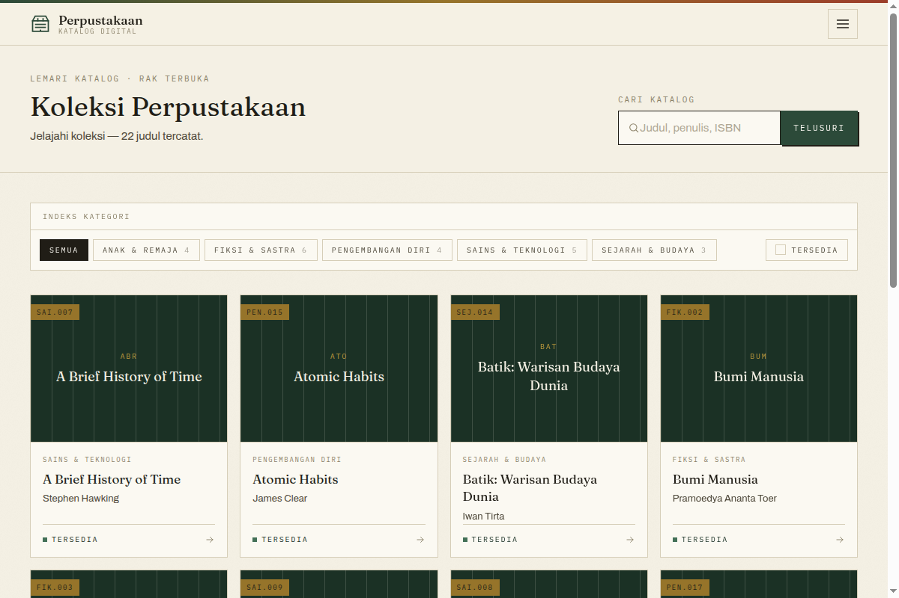

# Perpustakaan

Sistem perpustakaan berbasis web: katalog publik, peminjaman, dan antrean reservasi
otomatis. Dibangun dengan Laravel + Blade + Tailwind, tanpa SPA.



## Masalah yang diselesaikan

Perpustakaan kecil biasanya mencatat peminjaman di buku besar atau spreadsheet. Akibatnya
satu judul bisa dipinjam dua orang sekaligus, tidak ada catatan siapa memegang buku apa,
dan anggota yang ingin meminjam buku yang sedang habis tidak punya cara untuk "ikut
antre" — mereka harus datang lagi dan menebak kapan bukunya kembali.

Sistem ini menyelesaikan tiga hal itu: stok dijaga agar tidak minus, setiap pinjaman
tercatat per anggota, dan buku yang habis punya antrean reservasi yang otomatis
dipromosikan begitu bukunya dikembalikan.

## Fitur

**Sisi anggota**
- Katalog publik dengan pencarian (judul, penulis, ISBN) dan filter kategori.
- Detail buku dengan status ketersediaan.
- Reservasi buku yang stoknya habis, dengan posisi antrean.
- Dashboard pinjaman aktif dan riwayat.

**Sisi petugas (admin)**
- CRUD buku, kategori, dan peminjaman.
- Pencatatan pinjam/kembali; stok berkurang dan bertambah otomatis.
- Laporan peminjaman.

**Otomatisasi**
- Command `library:notify-overdue` mengirim email pengingat pinjaman terlambat,
  mempromosikan antrean reservasi saat stok kembali, dan mengedaluwarsakan reservasi
  yang tahanannya lewat batas. Ada `--dry-run` untuk melihat hasil tanpa mengirim email.

## Keputusan teknis yang menarik

- **Antrean reservasi terpusat di satu service.** Aturan "satu anggota hanya boleh punya
  satu reservasi terbuka per judul" dan "reservasi paling depan otomatis naik saat buku
  dikembalikan" ada di `app/Services/ReservationService.php`, bukan tersebar di controller.
- **Row lock saat reservasi.** `lockForUpdate()` di dalam transaksi mencegah dua anggota
  mendapat slot yang sama saat stok cuma satu.
- **Reservasi yang tersedia punya masa tahan (`HOLD_DAYS`).** Kalau tidak diambil, sistem
  mengedaluwarsakannya dan mempromosikan antrean berikutnya, supaya buku tidak "nyangkut"
  di satu orang.
- **Peran tidak bisa disuntik lewat form.** `role` dan `member_code` tidak masuk
  `$fillable`; ada tes yang mencoba mengubahnya via mass assignment dan memastikan gagal.

## Keamanan

Ada tes khusus (`tests/Feature/SecurityTest.php`) untuk tiga jalur serangan yang paling
sering kena di aplikasi CRUD:

- **Mass assignment** — mengirim `role=admin` lewat form profil tidak mengubah peran.
- **XSS** — judul buku berisi `<script>` di-escape saat dirender.
- **SQL injection** — pencarian dengan payload `' OR 1=1` tidak membocorkan data.

## Stack

- **Laravel** (PHP 8.3) + **Blade** + **Tailwind CSS** + **Vite**
- **SQLite** secara default (mudah dipindah ke MySQL/PostgreSQL lewat `.env`)
- **PHPUnit** — 80 tes, 207 assertion
- Antrean & cache pakai driver database; tidak butuh Redis untuk jalan

## Cara menjalankan

```bash
composer install
npm install
cp .env.example .env
php artisan key:generate
php artisan migrate --seed
npm run build
php artisan serve
# buka http://localhost:8000
```

Akun hasil seeder tercantum di `database/seeders/DatabaseSeeder.php`.

## Tes

```bash
php artisan test
# 80 passed (207 assertions)
```

## Struktur

- `app/Http/Controllers/` — controller publik, anggota, dan `Admin/` untuk petugas.
- `app/Services/ReservationService.php` — seluruh aturan antrean reservasi.
- `app/Models/` — `Book`, `Category`, `Loan`, `Reservation`, `User`.
- `app/Console/Commands/NotifyOverdueCommand.php` — pekerjaan harian (pengingat + antrean).
- `app/Http/Requests/` — validasi form terpisah dari controller.
- `tests/Feature/` — tes per alur: katalog, reservasi, admin, keamanan, auth.
- `docs/panduan/` — panduan pengguna & petugas (deck presentasi).
